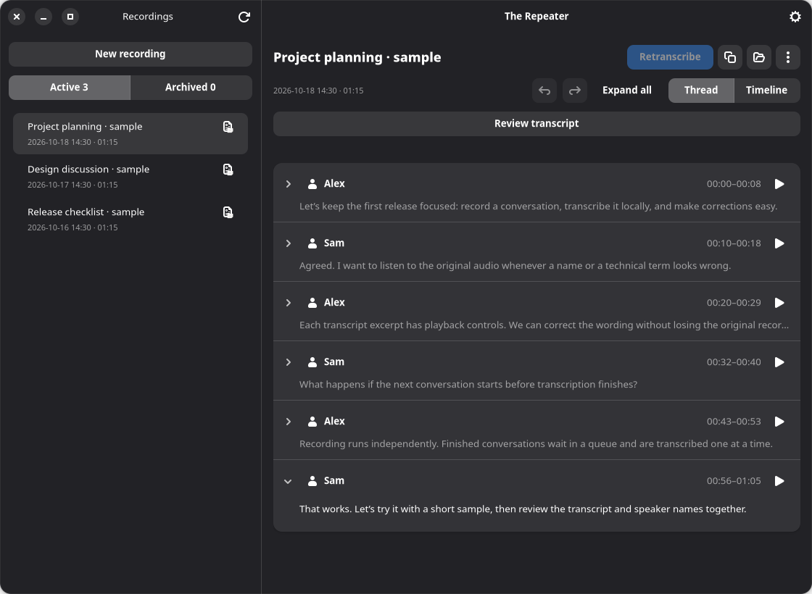

# Repeater

Local-first conversation recording and offline transcription for Linux. Repeater records microphone and system audio into separate files, transcribes saved conversations, and lets you correct text and speaker identities in a native GTK application.

This is a development fork of [Parrot](https://github.com/turantekin/Parrot), not the original macOS application. The Linux application uses Python, GTK 4, libadwaita, PipeWire and local speech models. Parrot's SwiftUI application, live assistant and cloud integrations are not Repeater features.



*Actual GTK application with synthetic sample conversations; no private meeting content.*

## What works today

- **Explicit two-track recording.** Choose a microphone and the output carrying your call. Start and stop capture yourself; no meeting bot joins the call.
- **Recording during transcription.** Start the next conversation while an older one transcribes. History, Settings and unrelated transcript editing/playback remain usable.
- **FIFO transcription queue.** Automatic post-recording and manual transcription requests share one queue. One recording is transcribed at a time, with active work and waiting positions visible. Each request keeps its selected model/settings; failed jobs report an error and the next job proceeds without automatic retries.
- **Two manually selected local models.** Multitalker Parakeet or Nemotron 3.5 with diarization. The desktop keeps its selected model loaded between jobs and unloads it on exit; changing model/configuration replaces it on the next job.
- **Editable transcripts and speaker identities.** Thread and Timeline views, word-timed excerpts when available, speaker naming and per-snippet corrections, persistent Undo/Redo, and source-matched audio playback.
- **Opt-in remembered voices.** Enroll from confirmed speaker snippets and use local voice matching on later transcripts. Matching can be disabled and profiles forgotten. This requires the separate local TitaNet embedding checkpoint and NeMo runtime used by [the voice-profile implementation](linux/voices.py); ordinary transcription setup does not install that checkpoint. Corrections do not automatically retrain transcription models or relearn voices.
- **Optional transcript review.** An explicitly configured local OpenAI-compatible model can suggest suspicious passages for human review. Keep, edit or skip findings; nothing is automatically rewritten. The endpoint must support strict JSON-schema output and enough context for the transcript.
- **Local recording management.** Active/Archived history, Archive/Restore, whole-recording Trash with Undo, recording-specific recovery messages, and JSON, TXT and SRT transcript files.

### Model limits

| Model | Speaker capacity per mixed audio source | Languages |
|---|---|---|
| Multitalker Parakeet | Up to four distinct voices | English |
| Nemotron 3.5 + diarization | Eight slots | 32 explicit locales |

Fresh preferences default to Nemotron. Switching is manual: there is no automatic model selection or fallback. These capacities are model limits, not guarantees of correct speaker attribution or transcription. More than eight speakers per mixed source is not supported. Playback uses the original source track, not isolated-speaker audio separation.

## Run from source

There is no standalone Repeater installer or automatic updater. Use a Linux desktop with Python 3.10+, PipeWire and WirePlumber, `pw-dump`, `pw-record`, and preferably `pactl` for default-device selection.

The GUI requires PyGObject, GTK 4, libadwaita 1.5+, and GStreamer base/good plugins. Building and installing the speech runtimes also requires a C/C++ toolchain, CMake, Make, curl, checksum tools, OpenSSL development files and OpenBLAS. Parakeet CUDA needs an NVIDIA CUDA toolkit/driver; Nemotron setup needs `uv` and FFmpeg and creates an isolated Python/NeMo environment. Setup scripts do not install distribution packages. See [Linux prerequisites and setup](docs/linux-port.md#prerequisites-and-setup) for details.

Clone this repository with your normal GitHub credentials, enter its directory, and run:

```bash
make                                      # syntax sanity; does not record
make linux-setup                          # both pinned runtimes/models; Parakeet CUDA
# Or install one model:
# make linux-setup PROFILE=multitalker-parakeet MODE=cpu
# make linux-setup PROFILE=nemotron-3.5
make gui                                  # install the user-local launcher and open the app
```

Model installation requires network access. Recording and transcription run locally after setup. Installing both models is not required for recording-only use.

1. In **Settings → Model**, choose the model, language and CPU/GPU options.
2. Enter a title and select the microphone and call output.
3. Click **Record**, then **Stop recording** when finished. **Transcribe after stopping** queues transcription automatically; disable it for recording-only use.
4. Select a saved recording to transcribe manually, replay audio or correct its transcript.

`make install-desktop` updates the launcher without opening the app. It points at the checkout, so keep that directory in place. Shortcuts: Ctrl+N opens the recorder, Ctrl+, opens Settings, Ctrl+R refreshes history, and Ctrl+Q requests close.

### CLI

```bash
make help
make devices                              # list devices; does not record
python3 linux/parrot.py record --title 'Example conversation'
# Ctrl+C stops and saves. Add --duration 30 for an explicit timed recording.
python3 linux/parrot.py transcribe /absolute/path/to/session --profile multitalker-parakeet --cpu
```

The existing `parrot.py` filename and `parrot` storage namespace are retained for compatibility; they do not identify the GitHub project as Parrot. Bare CLI invocation and `make run` show help only.

## Privacy and recovery limits

The selected output monitor captures all audio routed to that output, not just the meeting. Linux capture has no acoustic echo cancellation, so speaker audio can leak into the microphone track.

- Audio, transcription, speaker profiles and corrections remain local. Optional review sends transcript text—not audio—to the local or private-network endpoint you configure, with no cloud fallback.
- Recordings live under `${XDG_DATA_HOME:-$HOME/.local/share}/parrot/meetings/`; settings live under `${XDG_CONFIG_HOME:-$HOME/.config}/parrot/settings.json`. Recordings and downloaded models are excluded from version control.
- **The transcription queue does not survive restart.** Closing cancels active transcription and clears waiting requests, but keeps saved audio and prior transcripts for later manual transcription. It also finalizes an active recording before normal exit.
- Active/queued recordings are protected against editing, review, moving, deletion and duplicate scheduling until their jobs finish. Unrelated recordings remain usable.
- Failed or cancelled retranscription preserves the previous corrected transcript; successful replacement is undoable. A forced kill or machine crash cannot guarantee recording finalization. A failed recording can leave audio files worth inspecting, but is not proof of a complete capture.

Review findings, voice matches and word alignment can be wrong. Listen and verify consequential details; none of them is ground truth.

## Ideas from Parrot—not implemented in Repeater

Parrot has capabilities worth considering, but this list is **inspiration, not an accepted roadmap or a claim of Linux support**:

- **Live assistance and a document knowledge base:** grounded answer suggestions, open-question cards, commitments and in-call coaching.
- **Post-call reports and meeting search:** timestamp-backed summaries, action items, follow-up drafts and conversational search across past calls.
- **Calendar-aware workflows and call profiles:** attendee/title suggestions, call-specific instructions, and explicit recording prompts when a call begins.
- **Meeting integrations:** read-only MCP access for assistants and opt-in exports/webhooks to other tools.
- **Capture and desktop conveniences:** acoustic echo cancellation, live transcription, audio-file import, tray controls and packaged updates.

Read [the upstream feature descriptions](https://github.com/turantekin/Parrot/blob/67c81ea156d479e7ec247f56f3fe65bde009e286/README.md) for the source of these ideas. Repeater does not currently provide those workflows, cloud transcription or automatic crash recovery. The original macOS source remains in this repository for provenance; it is not the Linux runtime.

## Development and documentation

```bash
make linux-check                          # behavioral tests; no private audio
make linux-gtk-check                      # isolated native-widget checks; requires a display
```

- [Linux workflows, storage, setup and verification](docs/linux-port.md)
- [Source file map](FILEMAP.md)
- [Android feasibility research](docs/android-feasibility.md)—exploration, not an Android implementation

This is a source-run development project, not a production-quality or recognition-accuracy guarantee. Queue persistence has been discussed but is not implemented.

## Attribution and license

Repeater is derived from [Parrot](https://github.com/turantekin/Parrot). Original source, artwork, copyright notices and attribution are retained. See [LICENSE](LICENSE) for GPL-3.0 terms; third-party runtimes and model checkpoints retain their own licenses.
